

  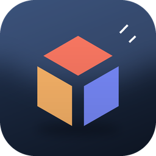

<h1 align="center">ModelFolio</h1>

<b>내 3D 작품을 보여 줄 준비 · Your models, ready to show.</b> 
3D 모델 포트폴리오 뷰어 · A 3D model portfolio viewer for Windows

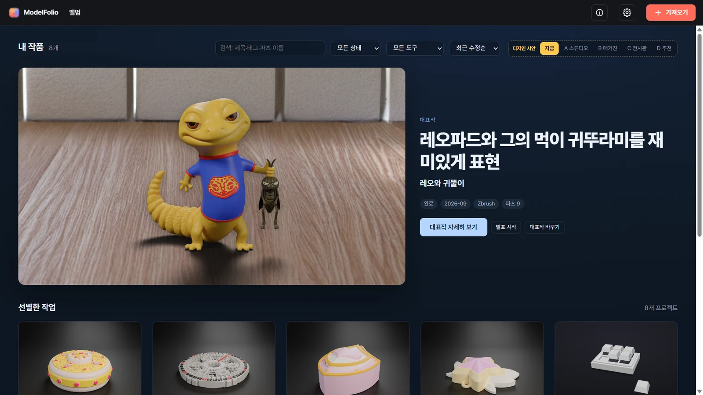

[한국어](#한국어) · [English](#english) · [바뀐 점 · Changelog](CHANGELOG.md)

---

## 한국어

3D로 만든 작품을 앨범처럼 모아 두고, 돌려 보고, 펼치고 조립하며, 사진처럼 렌더링해 보여 주려고 만들었습니다.

### 특징

- **가져오기:** 3MF(Fusion·Bambu Studio·PrusaSlicer), STEP·IGES, OBJ(ZBrush 폴리페인트 포함), FBX, glTF·GLB, STL, PLY, DAE, 3DS 등. 파일을 창에 끌어다 놓아도 됩니다. glTF·FBX처럼 노드 계층이 있는 파일은 그 묶음(문짝·바퀴 등)으로 분해 그룹을 자동으로 잡습니다.
- **Bambu 3MF:** 필라멘트 색, 붓 칠 색, 빼기용 부피까지 그대로.
- **조립 연출:** 부품이 빠지는 방향과 순서를 자동으로 분석하고, 분해 경로를 직접 편집할 수 있습니다. 펼치면 바깥부터 차례로 날아가고, 조립하면 순서대로 날아와 '착' 끼워집니다.
- **부품 전개도:** 모든 부품을 바닥에 눕혀 종류별로 묶고 조립 순서대로 펼칩니다. 이름표(×개수)와 설명을 달고, 끌어서 다시 배치할 수 있습니다.
- **만지기:** 부품을 끌어 빼고 제자리에 놓으면 딸깍 붙습니다. 이동·회전 기즈모(15° 맞춤, 반듯하게), 정밀 입력, 되돌리기, 간섭 검사.
- **키 스위치:** 부품을 눌리는 키로(청·갈·적축 소리, 키보드 키·도레미 음 연결). 키보드 플레이트의 MX 구멍에 스위치를 꽂고 키캡을 끼울 수 있습니다.
- **자동 칠하기:** 파츠 이름(한/영)과 모양을 보고 테마(실차·피규어·기계·장난감)에 맞춰 색·재질을 칠합니다. 배색마다 지금 작품으로 입힌 미리보기 그림을 보고 고르며, 좌우 대칭 파츠는 같은 색으로 칠합니다.
- **부위 칠하기 붓:** 한 덩어리 메시도 부위별로 칠합니다. 표면을 클릭하면 꺾이는 곳·홈·색 경계까지 비슷한 면을 자동으로 고르고(넓게·좁게), 붓으로 문질러 칠하거나 고른 곳 경계를 다듬을 수 있습니다. 고품질 렌더와 3MF·GLB 내보내기에도 그 색이 들어갑니다.
- **고품질 렌더링:** 경로 추적(Mitsuba 3), 재질 22종(PLA·레진·투명·금·크롬 등), 조명 조절, HDRI, 스튜디오 배경지, 구도·렌즈, 투명 PNG, 4K. NVIDIA 그래픽카드면 몇 초.
- **AI 배경(추가 팩, 선택):** 모델은 렌더 그대로 두고 배경만 AI(Stable Diffusion XL)가 그립니다. 내 PC의 그래픽카드에서 만듭니다.
- **작품 공유 파일(.mfolio):** 작품 하나를 파일 하나로 내보내 다른 ModelFolio에서 가져옵니다. 편집용(원본 포함)·보기용을 고를 수 있고, PC 경로와 사진의 촬영 정보(EXIF)는 지워서 내보냅니다. 보기용은 모델과 사진을 암호화(AES-GCM)해 ModelFolio에서만 열리고, 받은 사람은 모델 파일로 꺼내거나 다시 내보낼 수 없습니다. 메시를 거칠게(50%·25%) 하거나 비밀번호를 걸 수도 있습니다.
- **모델로 내보내기:** 3MF(파츠 이름·색 유지, Bambu Studio에서 열기, Fusion에서는 삽입 → 메시 삽입으로 확인)·GLB·STL(파츠마다 하나, zip). 조립 상태 또는 지금 화면 그대로(분해·옮긴 자리). 부위 칠하기 색은 3MF(삼각형마다)·GLB(꼭짓점 색)에 담깁니다.
- **작품 상세 페이지:** 큰 완성 이미지와 요약, 디테일과 구조(부품 구성 자동) · 와이어프레임 · 재질과 조명 · 제작 과정 · 완성 및 회고.
- **앨범:** 대표작, 검색(파츠 이름까지)·태그·상태 필터, 앨범 디자인 시안, 장면 저장, 발표 모드, 조립 게임, 백업.
- **한국어 / English:** 설정 → 일반 → 언어.
- **예제 작품:** 처음 실행하면 곰 키링 예제를 넣어 바로 돌려 보고 분해해 볼 수 있습니다.
- **문제 보고:** About(ⓘ) → [문제 보고]가 버전·Windows·그래픽카드를 채운 GitHub Issue 양식을 엽니다.
- **새 버전 알림:** 하루 한 번 GitHub 릴리스를 확인합니다. [지금 설치]는 설치 파일을 받아 SHA-256을 확인한 뒤 설치하고, [나중에]·[이 버전 건너뛰기]도 고를 수 있습니다. 설정 → 일반 → 업데이트에서 끌 수 있습니다.

 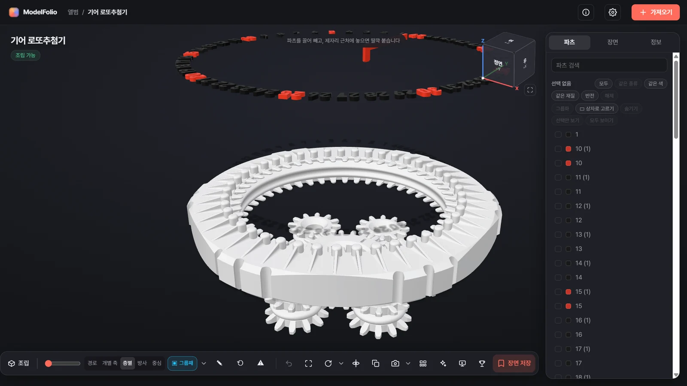

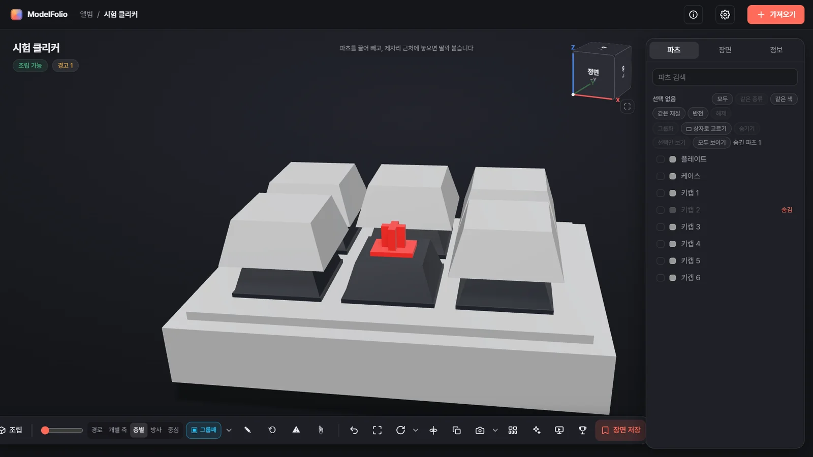 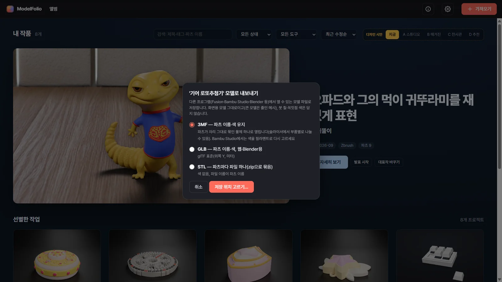

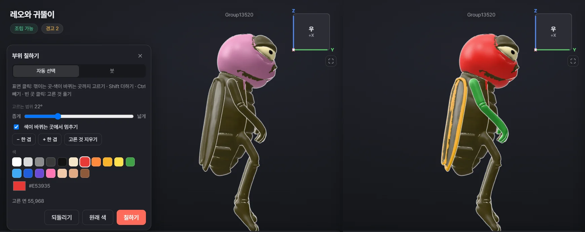

### 내려받기

[Releases](../../releases)에서 **`ModelFolio-Setup-<버전>.exe`** 를 받아 실행하면 바로 설치됩니다.
- 관리자 권한 없이 내 계정에만 설치합니다(`%LOCALAPPDATA%\Programs\ModelFolio`). 지우기: Windows 설정 → 앱 → ModelFolio.
- 작품 라이브러리는 `문서\ModelFolio Library`에 저장됩니다(문서 폴더가 OneDrive 안이면 동기화 충돌을 피해 `C:\Users\<이름>\ModelFolio Library`). 설정 → 일반에서 바꿀 수 있고, 앱을 지우거나 업데이트해도 그대로 남습니다.
- 설치 파일에 코드 서명이 없어 처음 실행할 때 "Windows의 PC 보호" 창이 뜰 수 있습니다. **[추가 정보] → [실행]** 을 누르세요. 받은 파일은 릴리스의 `SHA256SUMS-<버전>.txt`로 확인할 수 있습니다(PowerShell: `Get-FileHash ModelFolio-Setup-<버전>.exe`).

### 권장 사양

- Windows 10·11 64비트, Microsoft Edge WebView2 런타임(Windows 11에는 기본으로 들어 있고, Windows 10도 대부분 설치돼 있습니다).
- 외장 그래픽카드 권장. 3D 화면은 내장 그래픽으로도 되지만, 고품질 렌더링은 NVIDIA(CUDA)에서 몇 초, 없으면 CPU로 느리게 그립니다.
- 메모리 8GB 이상(수백만 삼각형의 큰 모델은 16GB).
- AI 배경 팩(선택): NVIDIA 그래픽카드(VRAM 8GB 이상), 디스크 약 10GB.

### 개인정보·인터넷 사용

- 인터넷은 이 세 가지에만 씁니다: **새 버전 확인**(하루 한 번 GitHub, 끌 수 있음), **AI 배경 팩 설치**(python.org·PyTorch·Hugging Face), **HDRI 조명 받기**(Poly Haven).
- 사용 통계나 작품·사진·로그를 보내지 않습니다. 작품과 라이브러리는 내 PC에만 있습니다.
- AI 배경 팩의 모델 가중치(Stable Diffusion XL 인페인팅 [diffusers/stable-diffusion-xl-1.0-inpainting-0.1](https://huggingface.co/diffusers/stable-diffusion-xl-1.0-inpainting-0.1), 각도 맞춤 [diffusers/controlnet-depth-sdxl-1.0-small](https://huggingface.co/diffusers/controlnet-depth-sdxl-1.0-small))는 ModelFolio에 들어 있지 않고, 팩을 설치할 때 사용자 PC로 Hugging Face에서 직접 받습니다. 모델 라이선스는 [CreativeML OpenRAIL++-M](https://huggingface.co/stabilityai/stable-diffusion-xl-base-1.0/blob/main/LICENSE.md)이며, 만든 그림도 그 사용 제한을 따릅니다.

### 알려진 한계

- **서명 없음:** 설치 파일에 코드 서명이 없어 SmartScreen 경고가 뜹니다(위 [내려받기](#내려받기) 참고).
- **날짜 칸:** 영어 화면에서도 작품 정보의 날짜 칸("----년 --월")은 Windows 언어를 따릅니다.
- **열린 메시의 간섭 검사:** 구멍이 있거나 깨진(닫히지 않은) 메시는 겹친 깊이·부피를 어림으로 계산합니다.
- **부위 칠하기 경계:** 자동 고르기는 모양(꺾임·홈)과 색으로 경계를 찾아서, 홈 없이 매끈하게 이어진 곳(몸에 붙은 팔 등)은 넘어갈 수 있습니다. 그때는 범위를 좁히거나 붓으로 다듬으세요. 크롬·금속처럼 색이 정해진 재질에서는 칠한 색이 보이지 않습니다.
- **보기용 보호:** 보기용 공유 파일의 암호화는 일반 사용자가 모델을 꺼내 쓰는 것을 막는 수준입니다. 그래픽 메모리에서 뽑아내거나 앱을 분석하는 것까지는 막지 못합니다(필요하면 '거칠게'를 함께 쓰세요).

### 라이선스

[ModelFolio 이용허락서](LICENSE.txt) — **개인·1인 사업자·학교·비영리 무료 · 근로자를 둔 사업장과 공공기관의 업무용 사용은 문의(ciaon.dev@gmail.com) · 앱 자체의 판매·유료 서비스 제공 금지 · 결과물 제한 없음(유료 의뢰 작업 납품 가능).**

ModelFolio에는 오픈소스 구성 요소(three.js, Mitsuba 3, Assimp, Open CASCADE 등)가 들어 있습니다. [THIRD_PARTY_NOTICES.txt](THIRD_PARTY_NOTICES.txt)를 보세요.

### 만든 사람 · 후원

- 만든 사람: **Ciaon** · 문의 ciaon.dev@gmail.com
- ModelFolio는 개인·1인 사업자에게 무료입니다. 쓸모가 있었다면 커피 한 잔으로 응원해 주세요.
  - 해외·카드: [PayPal (paypal.me/SupportCiaon)](https://paypal.me/SupportCiaon)
  - 국내: 카카오페이 — 휴대전화로 아래 QR을 찍어 주세요

---

## English

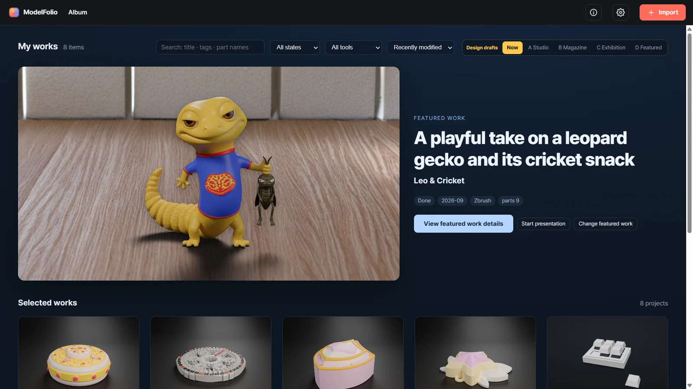

ModelFolio keeps your 3D work in an album, and lets you turn it, take it apart and put it back together, and render it like a product photo.

### Features

- **Import:** 3MF (Fusion, Bambu Studio, PrusaSlicer), STEP/IGES, OBJ (with ZBrush polypaint), FBX, glTF/GLB, STL, PLY, DAE, 3DS and more. Drag files onto the window. Files with a node hierarchy, such as glTF and FBX, get explode groups automatically from those groupings (doors, wheels and so on).
- **Bambu 3MF:** filament colors, painted colors and negative volumes.
- **Assembly animation:** analyzes the direction and order parts come out, and lets you edit explode paths yourself. Parts fly out in order and snap back in sequence.
- **Parts layout:** lays every part flat, grouped by kind and in assembly order, with name tags (×count) and notes; rearrange by dragging.
- **Hands-on:** pull parts out and drop them back with a click; move/rotate gizmo with 15° snapping, square-up, numeric input, undo and interference check.
- **Key switches:** turn parts into keys you can press (blue/brown/red switch sounds, keyboard keys and do-re-mi notes). Plug MX switches into a keyboard plate and fit keycaps on them.
- **Auto color:** reads part names (Korean/English) and shapes and paints colors and materials for a theme (real car, figure, machine, toy). Pick a palette from preview thumbnails of your own work; mirrored parts get matching colors.
- **Region paint brush:** paint regions of even a single-piece mesh. Click a surface to auto-select similar faces up to creases, grooves and color changes (narrow or wide), or brush to paint and refine the selection edge. The colors carry into high-quality renders and 3MF/GLB export.
- **High-quality rendering:** path tracing (Mitsuba 3), 22 materials, adjustable lights, HDRI, seamless studio backdrop, framing and lens, transparent PNG, 4K. Seconds on an NVIDIA GPU.
- **AI backgrounds (optional add-on):** the model stays exactly as rendered; only the background is generated (Stable Diffusion XL), on your own GPU.
- **Share files (.mfolio):** export one work as one file and import it into another ModelFolio. Choose Editable (with originals) or View-only; PC paths and photo capture info (EXIF) are removed. View-only files encrypt the model and photos (AES-GCM) so they open only in ModelFolio, and the recipient can't export or re-share the model. You can also make the mesh coarser (50% or 25%) or add a password.
- **Model export:** 3MF (keeps part names and colors; verified to open in Bambu Studio, and in Fusion via Insert → Insert Mesh), GLB, or STL (one per part, zipped). Assembled, or exactly as shown (exploded and moved positions). Region paint colors are included in 3MF (per triangle) and GLB (vertex colors).
- **Work page:** a large hero image and summary, then Detail & structure (automatic parts list), Wireframe, Materials & lighting, Process and Retrospective.
- **Album:** featured work, search (including part names), tags and status filters, album design styles, saved scenes, presentation mode, assembly game, backup.
- **English / 한국어:** Settings → General → Language.
- **Sample work:** on first launch you can add a Bear Keyring sample to rotate and explode right away.
- **Report a problem:** About (ⓘ) → Report a problem opens a GitHub issue form with the version, Windows and GPU filled in.
- **Update notice:** checks GitHub releases once a day. Install now downloads the installer, verifies its SHA-256 and installs it; you can also choose Later or Skip this version. Turn it off in Settings → General → Updates.

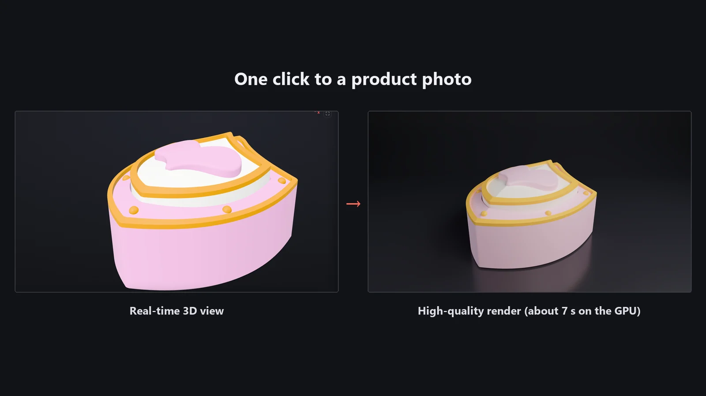 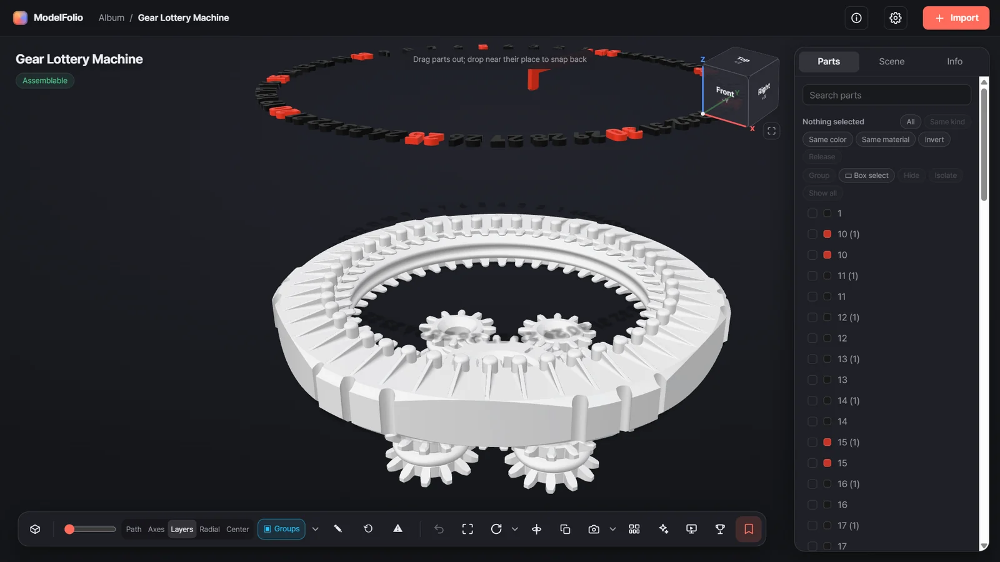

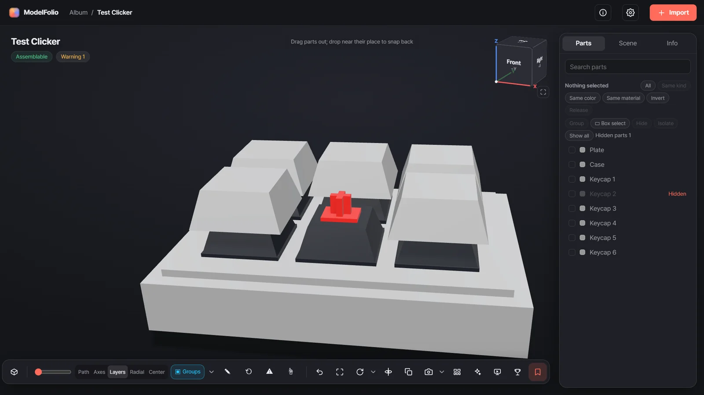 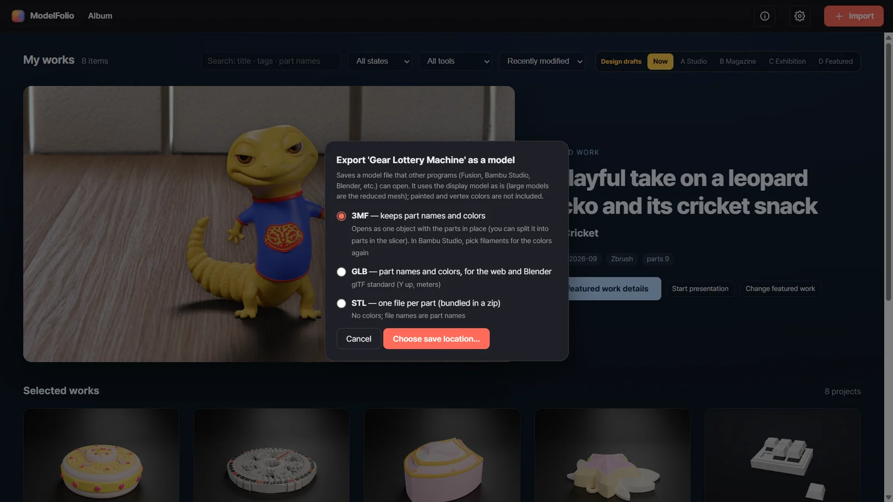

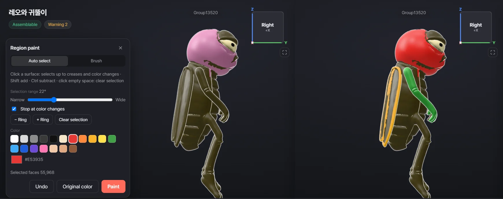

### Download

Download **`ModelFolio-Setup-<version>.exe`** from [Releases](../../releases) and run it.
- Installs for the current user without admin rights (`%LOCALAPPDATA%\Programs\ModelFolio`). Uninstall from Windows Settings → Apps → ModelFolio.
- Your library goes in `Documents\ModelFolio Library` (or `C:\Users\<name>\ModelFolio Library` if Documents is inside OneDrive, to avoid sync conflicts). You can change it in Settings → General; it is kept across updates and uninstall.
- The installer is not code-signed, so Windows may show "Windows protected your PC" on first run. Click **More info → Run anyway**. To check your download, compare it with `SHA256SUMS-<version>.txt` in the release (PowerShell: `Get-FileHash ModelFolio-Setup-<version>.exe`).

### Requirements

- Windows 10/11 64-bit with the Microsoft Edge WebView2 Runtime (built into Windows 11 and installed on most Windows 10 PCs).
- A dedicated GPU is recommended. The 3D view runs on integrated graphics, but high-quality rendering takes seconds on an NVIDIA GPU (CUDA) and is much slower on the CPU.
- 8 GB RAM or more (16 GB for models with millions of triangles).
- AI background pack (optional): NVIDIA GPU with 8 GB+ VRAM, about 10 GB of disk.

### Privacy and internet use

- The app goes online for only three things: **update check** (once a day, GitHub; can be turned off), **installing the AI background pack** (python.org, PyTorch, Hugging Face) and **downloading HDRI lighting** (Poly Haven).
- No usage statistics, and your works, images and logs are never sent anywhere. Your works and library stay on your PC.
- The AI pack's model weights (Stable Diffusion XL inpainting [diffusers/stable-diffusion-xl-1.0-inpainting-0.1](https://huggingface.co/diffusers/stable-diffusion-xl-1.0-inpainting-0.1) and, for angle matching, [diffusers/controlnet-depth-sdxl-1.0-small](https://huggingface.co/diffusers/controlnet-depth-sdxl-1.0-small)) are not included in ModelFolio; they are downloaded by you from Hugging Face when you install the pack. They are licensed under [CreativeML OpenRAIL++-M](https://huggingface.co/stabilityai/stable-diffusion-xl-base-1.0/blob/main/LICENSE.md), and images you make follow its use restrictions.

### Known limitations

- **Not code-signed:** the installer triggers a SmartScreen warning (see [Download](#download)).
- **Date field:** the date field in work info ("----년 --월") follows the Windows language, even in the English UI.
- **Interference on open meshes:** for meshes with holes or broken (non-closed) surfaces, overlap depth and volume are estimates.
- **Region paint boundaries:** auto-select finds edges by shape (creases, grooves) and color, so it can run past smooth joins with no groove (an arm fused to a body, for example). Narrow the range or refine with the brush. Paint doesn't show on fixed-color materials such as chrome and metal.
- **View-only protection:** encryption of view-only share files stops ordinary users from taking the model out; it can't stop capturing it from graphics memory or reverse-engineering the app (use "coarser" as well if that matters).

### License

[ModelFolio License](LICENSE.txt) — **Free for individuals, sole proprietors, schools and non-profits · business use at workplaces with employees or public institutions: contact ciaon.dev@gmail.com · selling the app itself or offering it as a paid service is not allowed · no restrictions on your output (paid commissioned work is fine).**

ModelFolio includes open-source components (three.js, Mitsuba 3, Assimp, Open CASCADE and others); see [THIRD_PARTY_NOTICES.txt](THIRD_PARTY_NOTICES.txt).

### Made by · Support

- Made by **Ciaon** · ciaon.dev@gmail.com
- ModelFolio is free for individuals and sole proprietors. If you find it useful, you can buy me a coffee.
  - [PayPal (paypal.me/SupportCiaon)](https://paypal.me/SupportCiaon)
  - KakaoPay (Korea): scan the QR below with your phone

